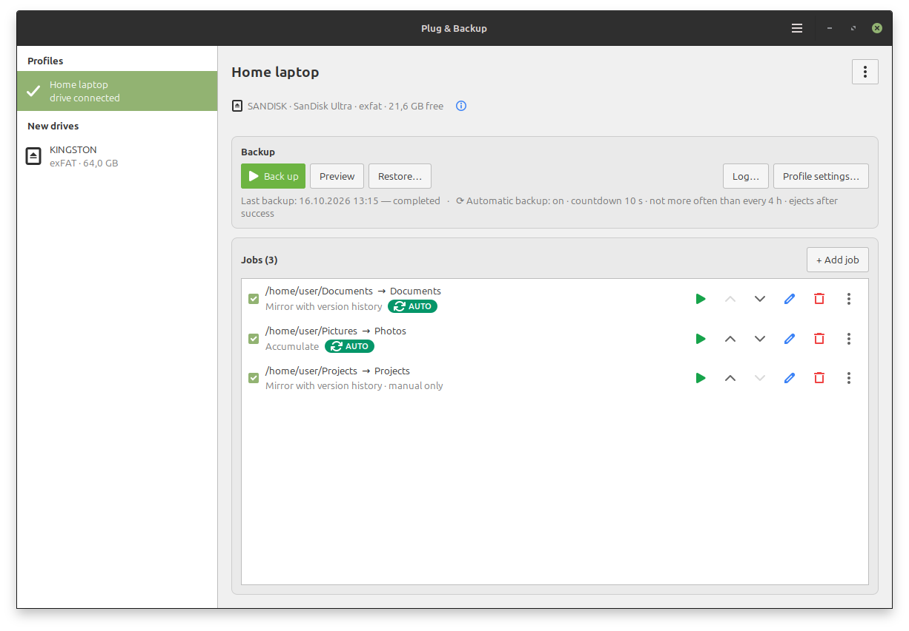
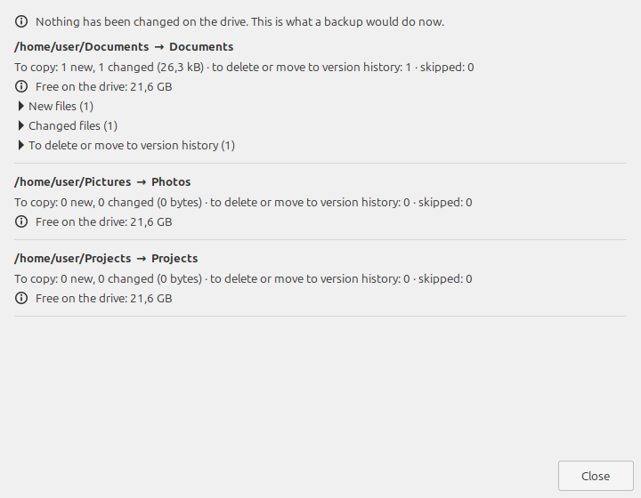
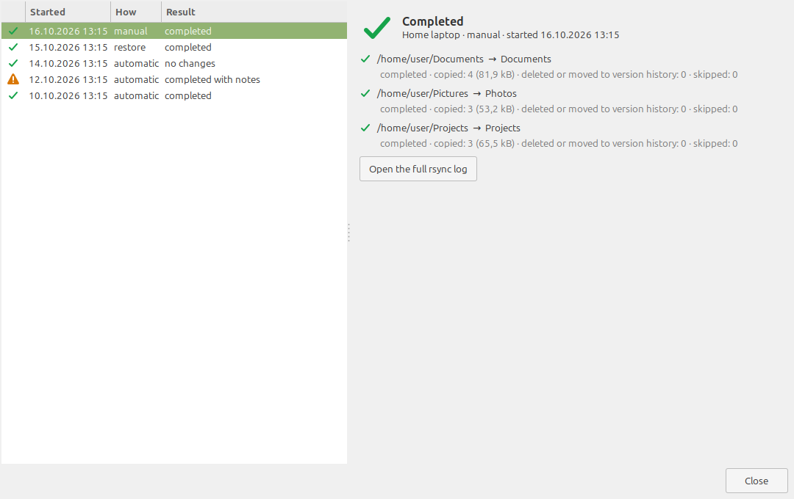
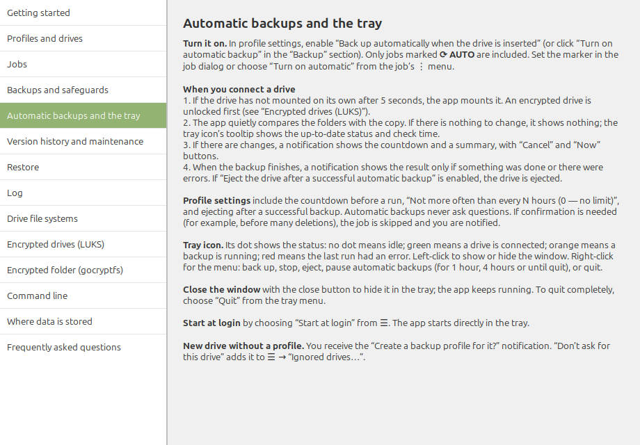

[Русский](README.ru.md) · **English**

# Plug & Backup

Back up selected folders to removable drives (USB flash drives, SD cards, external disks) on Linux Mint 22 Cinnamon — with one click or automatically when the drive is connected.



## Features

- One profile per drive: the drive is recognized by its UUID; jobs are pairs of “folder on the computer → folder on the drive”.
- Three copy modes: mirror with version history, mirror, accumulate. Copying is done with rsync; only changes are transferred.
- Safeguards: a profile marker on the drive (nothing is deleted without it), empty source, mass deletion, free space check, file names for FAT32/exFAT/NTFS, drive disconnected while writing.
- Preview, progress, stop, run log.
- Tray icon, notifications, automatic backup when the drive is connected with a countdown and a quiet check for changes, start at login.
- Restore to the original folders or to another folder; replaced files are set aside.
- Encryption: the whole drive (LUKS) or an encrypted folder on a regular drive (gocryptfs); passwords are kept in the keyring.
- Interface and help in English and Russian.
- Command line: `--list`, `--backup <profile>`, `--check`, `--hidden`, `--version`.

| Preview | Log |
|---|---|
|  |  |



## Requirements

Linux Mint 22 / Ubuntu 24.04: Python 3.12, GTK 3 (PyGObject), UDisks2, rsync, libnotify, libsecret, cryptsetup, XApp.StatusIcon or AyatanaAppIndicator3.
Optional: `gocryptfs` and `fuse3` (encrypted folder), `gnome-keyring` (password storage).

## Build and install

```sh
./build-deb.sh                                   # → dist/plugbackup_<version>_all.deb
sudo apt install ./dist/plugbackup_<version>_all.deb
```

The version is set in `plugbackup/__init__.py`.

## Translations

```sh
./tools/update-po.sh                             # update po/plugbackup.pot and po/ru.po
```

Strings in the code are in English; the Russian translation is `po/ru.po`. Help: `plugbackup/help_en.py` and `plugbackup/help_ru.py`.

## Tests

```sh
PYTHONDONTWRITEBYTECODE=1 python3 -m unittest discover -s tests -t .
```

Tests work only with temporary folders. Integration tests are skipped by default:
- `PLUGBACKUP_GOCRYPTFS_TESTS=1` — real gocryptfs (FUSE mount in a temporary folder);
- `PLUGBACKUP_IMAGE_TESTS=1` — file system images via UDisks2.

## Layout

```
plugbackup/core/   core without UI: drives, profiles, rsync, engine, restore, log, encryption
plugbackup/ui/     GTK 3 interface: window, pages, dialogs, tray, automation
plugbackup/cli.py  command line
data/              desktop file and icons
po/                translations
screenshots/       screenshots for this description
tests/             tests
tools/             helper scripts
build-deb.sh       .deb package build
```

## Where data is stored

On the computer: `~/.config/plugbackup/` (settings and profiles), `~/.local/state/plugbackup/log/` (log), `~/.local/share/plugbackup/restore-backup/` (files set aside during a restore).

On the drive: `PlugBackup/` — job copies, `.versions/` (version history) and `.plugbackup/` (profile marker); with an encrypted folder, the same inside `PlugBackup.enc/`.
